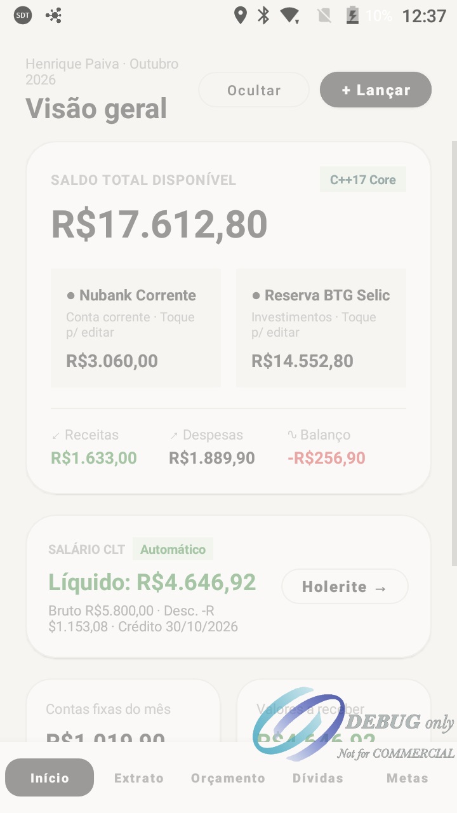

# FinPay Android 📱⚡

> **Engine Financeiro Nativo de Alta Performance em C++17 com UI Clássica em Kotlin (Android NDK)**

FinPay Android é a implementação nativa para Android do ecossistema financeiro **FinPay**. O projeto adota uma arquitetura híbrida de alto desempenho: toda a inteligência e complexidade de cálculos matemáticos, atuariais e amortizações é executada em **C++17 nativo compilado**, conectado via **JNI (Java Native Interface)** a uma interface clássica em **Kotlin** com suporte e validação em dispositivos legados e terminais **SmartPOS (ex: PAX A910, Android 6.0 Marshmallow, API 23)**.



---

## 🏛️ Arquitetura do Sistema

O projeto é estruturado em 4 camadas desacopladas que garantem separação clara de responsabilidades, alta testabilidade e portabilidade entre plataformas:

```
┌────────────────────────────────────────────────────────┐
│               1. UI Layer (Kotlin + XML)               │
│   MainActivity (ViewBinding) • 5 Abas Funcionais       │
└───────────────────────────┬────────────────────────────┘
                            │
┌───────────────────────────▼────────────────────────────┐
│         2. Data & Services (Kotlin Coroutines)         │
│  FinPayRepository (SharedPreferences Local-First)      │
│  MarketApiService (AwesomeAPI & BrasilAPI via IO)       │
└───────────────────────────┬────────────────────────────┘
                            │
┌───────────────────────────▼────────────────────────────┐
│             3. JNI Bridge (C++ / NDK)                  │
│    FinPayNativeEngine.kt  ◄───►  native-lib.cpp        │
└───────────────────────────┬────────────────────────────┘
                            │
┌───────────────────────────▼────────────────────────────┐
│               4. Core Engines (C++17)                  │
│  PayrollCalculator • DateEngine • DebtSimulator        │
│  YieldCalculator                                       │
└────────────────────────────────────────────────────────┘
```

---

## 🚀 Módulos em C++17 (NDK Core)

Todos os algoritmos estão localizados em `app/src/main/cpp/`:

### 1. `PayrollCalculator` (Holerite CLT Progressivo)
* Cálculo progressivo por faixas oficiais do **INSS** (alíquotas progressivas de 7,5% a 14% com teto).
* Base de cálculo para **IRRF** com dedução por dependente (R$ 189,59) e faixas progressivas (7,5% a 27,5%).
* Retorna resumo estruturado com Salário Bruto, INSS, IRRF, Total de Descontos e Salário Líquido.

### 2. `DateEngine` (Algoritmo de Meeus & Feriados Nacionais)
* Implementação do **Algoritmo Butcher/Meeus** para computação astronômica da Páscoa no calendário gregoriano.
* Cálculo dinâmico dos feriados móveis brasileiros: **Carnaval (-47 dias)**, **Sexta-Feira Santa (-2 dias)** e **Corpus Christi (+60 dias)**.
* Mapeamento de feriados nacionais fixos (Tiradentes, Dia do Trabalho, Independência, Finados, etc.).
* Cálculo preciso de dias úteis em qualquer mês e projeção do 5º dia útil para crédito salarial.

### 3. `DebtSimulator` (Amortização e Quitação de Dívidas)
* **Tabela Price (Sistema Francês)**: Cálculo de prestação fixa via fórmula de anuidade composta:
  $$PMT = PV \times \frac{i \times (1+i)^n}{(1+i)^n - 1}$$
* **Tabela SAC (Sistema de Amortização Constante)**: Amortização constante com parcelas decrescentes e recálculo dinâmico de juros sobre saldo devedor.
* **Estratégias de Quitação**:
  * **Avalanche**: Prioriza dívidas com maior taxa de juros nominal (maximiza economia financeira).
  * **Bola de Neve (Snowball)**: Prioriza dívidas com menor saldo devedor (maximiza vitórias comportamentais).

### 4. `YieldCalculator` (Rendimentos & Investimentos)
* Simulação de rendimento comparativo entre **CDI / Selic**, **Poupança** (regra da Selic > 8.5% e <= 8.5%) e **IPCA**.

---

## 🌐 Integrações de APIs de Mercado

Para manter a paridade com o ecossistema FinPay, o app consome serviços REST em background via `Kotlin Coroutines` (`Dispatchers.IO`):

* **AwesomeAPI**:
  * Cotações em tempo real de Dólar comercial (`USD`), Euro (`EUR`) e Bitcoin (`BTC`).
* **BrasilAPI**:
  * Taxas referenciais oficiais (Selic e CDI).
  * Calendário de feriados bancários e nacionais.

---

## 💾 Persistência Local-First

* Implementada em `FinPayRepository.kt`.
* Utiliza `SharedPreferences` para armazenamento leve e sem dependências pesadas, ideal para dispositivos embarcados e SmartPOS.
* Salva e recupera perfis salariais, metas, simulações e dados de dívidas mesmo sem sinal de internet.

---

## 🛠️ Tecnologias & Requisitos

| Componente | Versão / Configuração |
|---|---|
| **Linguagem Principal** | C++17 (Core) / Kotlin 1.9.22 (App) |
| **Android Gradle Plugin** | 8.3.0 |
| **NDK** | 26.1.10909125 |
| **CMake** | 3.22.1 |
| **Min SDK** | API 23 (Android 6.0 Marshmallow) |
| **Target SDK** | API 34 (Android 14) |
| **ABIs Suportadas** | `armeabi-v7a`, `arm64-v8a`, `x86`, `x86_64` |
| **Dispositivo Homologado** | PAX A910 (POS Terminal, 1GB RAM, armeabi-v7a) |

---

## 📦 Como Compilar e Executar

### 1. Via Linha de Comando (Gradle)

```powershell
# Clonar o repositório
git clone https://github.com/Henrique06Paiva/finpay-android.git
cd finpay-android

# Compilar versão Debug com NDK C++
./gradlew assembleDebug

# Instalar no dispositivo ou emulador conectado via ADB
adb install -r app/build/outputs/apk/debug/app-debug.apk
```

### 2. Via Android Studio

1. Abra o Android Studio (versão Hedgehog ou superior).
2. Selecione **File > Open** e selecione a pasta do projeto.
3. Aguarde o Gradle Sync e a compilação do CMake.
4. Conecte seu smartphone ou terminal POS via USB (com Depuração USB ativada).
5. Clique no botão **Run (Shift + F10)**.

---

## 🌿 Estrutura de Branches (Git Flow)

* `main`: Código de produção, versões estáveis e releases oficiais.
* `develop`: Branch ativa de desenvolvimento de novas features e melhorias de performance.

---

## 👨‍💻 Autor

Desenvolvido por **Henrique Paiva** ([@Henrique06Paiva](https://github.com/Henrique06Paiva)).
Parte do ecossistema de soluções financeiras de alta precisão **FinPay**.
